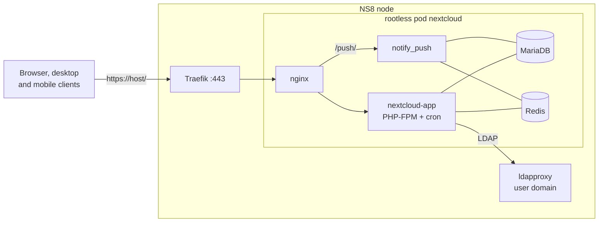

# ns8-nextcloud-next

A [Nextcloud](https://nextcloud.com) module for [NethServer 8](https://github.com/NethServer/ns8-core),
built on the latest Nextcloud release and the stable branch of its dependencies.
It is a fork of [ns8-nextcloud](https://github.com/NethServer/ns8-nextcloud) made to test
new versions early.

There is no migration from ns8-nextcloud. Install it as a new module, next to the old one
if needed.

| Component | Version |
| --- | --- |
| Nextcloud | 35, official `fpm-alpine` image, PHP 8.5 |
| MariaDB | 12.3 LTS |
| Redis | 8 |
| nginx | 1.30 stable |
| notify_push | 1.4 |



## Documentation

- [Admin guide](docs/admin-guide.md): install, configure, user domain, mail, Collabora,
  two-factor authentication, backup and restore, troubleshooting.
- [User guide](docs/user-guide.md): for the person who uses Nextcloud. Log in, connect the
  desktop and mobile clients, set up two-factor authentication.
- [Architecture](docs/architecture.md): containers, systemd units, module state, actions and
  what each one writes.

## Quick start

```sh
add-module ghcr.io/stephdl/nextcloud-next:latest 1
```

The output of the command returns the instance name, for example `nextcloud-next1`. Then fill
in the Settings page, or:

```sh
api-cli run module/nextcloud-next1/configure-module --data '{"host": "cloud.example.org", "lets_encrypt": false, "domain": "ad.example.org", "password": "Admin-pass-2026", "internal_smarthost": false}'
```

`host` and `internal_smarthost` are required. Leave `domain` empty to use only local
Nextcloud accounts. Let's Encrypt needs a public DNS name for `host` pointing to the node:
set `lets_encrypt` to `true` only then.

`password` is the password of the Nextcloud `admin` account. It is used only at the first
start, when Nextcloud installs itself. Changing it later in Settings does not change the
account. See [Admin password](docs/admin-guide.md#admin-password).

Open `https://cloud.example.org` and log in as `admin`, or with an account of the user domain.

## Known limits

- No upgrade path from ns8-nextcloud, and no stable release of this fork yet. Each future
  Nextcloud major version must be installed in order: 35, then 36. Do not skip one.
- `zzz_nethserver.conf` and `nginx.conf` are written again at each module update. Manual
  changes to them are lost.
- Removing the user domain from Settings does not remove the LDAP configuration from
  Nextcloud. See [Change the user domain](docs/admin-guide.md#change-the-user-domain).
- The MariaDB password is the same fixed value in every instance. The database listens only
  inside the pod, but anyone who reads the module state reads it too.

## Testing

The Robot Framework tests in [tests/](tests/) run in CI on a fresh NS8 node, on Rocky Linux 9
and Debian 13. They install the module, configure it, check that Nextcloud answers, create a
user, upload a file with WebDAV and read it back, check that Nextcloud 35 and MariaDB 12.3 are
running, then remove the module.

The update scenario enables the stephdl forge, installs the release published there, updates
it to the image under test, and checks that the configuration, u1 and its file survive.
CI runs only the install scenario until nextcloud-next is published in the forge. Then add
`update` to `scenarios` in [test-module.yml](.github/workflows/test-module.yml).

To run the suite on your own node, see
[Running tests locally](https://github.com/NethServer/ns8-github-actions/blob/v1/README.md#running-tests-locally).

The UI is translated by hand in every language under [ui/public/i18n](ui/public/i18n).
English is the source. Add a new key to every language in the same change.
