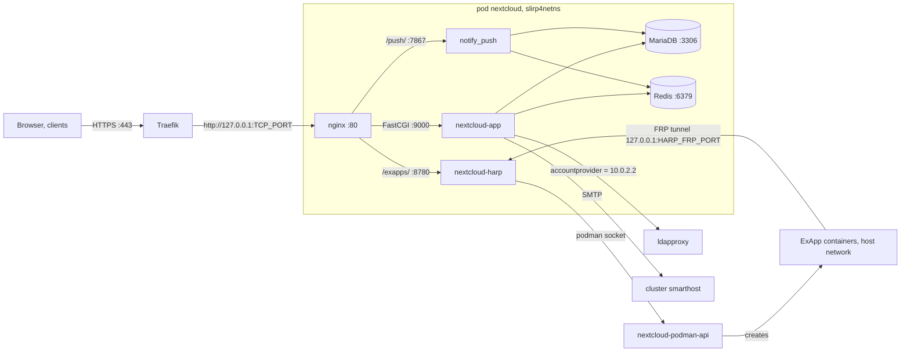

# Architecture

How ns8-nextcloud-next works inside. For the daily use of the module, see the
[admin guide](admin-guide.md).

## Network



The module is rootless. All containers share one pod, so they talk over `127.0.0.1`. The pod
publishes only nginx, on `127.0.0.1:${TCP_PORT}`, the port NS8 gives to the module. Traefik
routes `host` to it, with HTTP to HTTPS redirect.

The pod uses `slirp4netns:allow_host_loopback=true`. Inside the pod, `10.0.2.2` is the
loopback of the node. Nextcloud reaches ldapproxy there.

The module asks NS8 for a second port, `HARP_FRP_PORT`. The pod publishes the FRP port of
HaRP on `127.0.0.1:${HARP_FRP_PORT}`, see [External Apps](#external-apps).

## Components

| Container | Image | Role |
| --- | --- | --- |
| `nextcloud-app` | `ghcr.io/stephdl/nextcloud-next-app`, from `nextcloud:35-fpm-alpine` | PHP-FPM and cron, under supervisord |
| `nextcloud-nginx` | `nginx:1.30-alpine` | web server, static files, `/push/` proxy |
| `nextcloud-db` | `mariadb:12.3` | database |
| `nextcloud-redis` | `redis:8-alpine` | file locking and cache, append-only file |
| `nextcloud-notify_push` | `ghcr.io/stephdl/nextcloud-next-notify_push`, built from source | push notifications to the clients |
| `nextcloud-harp` | `ghcr.io/nextcloud/nextcloud-appapi-harp` | deploy daemon and proxy of External Apps, only when `exapps` is on |

The app image adds to the official one:

- ffmpeg, ImageMagick and the samba client, for previews and SMB external storage
- the PHP extensions `bz2`, `imap` and `smbclient`
- [ns.config.php](../nextcloud/ns.config.php): web updater off, update checker off, logs to
  stderr, maintenance window at 1:00 UTC, nginx as trusted proxy
- cron through busybox `crond`, every 5 minutes

The notify_push image builds the release set in
[notify_push/Dockerfile](../notify_push/Dockerfile) as a static binary.

### Volumes

| Volume | Content |
| --- | --- |
| `nextcloud-app-data` | `/var/www/html`: code, `config.php`, apps, user files |
| `nextcloud-db-data` | MariaDB data |
| `nextcloud-redis-data` | Redis append-only file |

nginx mounts the volumes of `nextcloud-app` to serve static files.

### Systemd units

| Unit | Role |
| --- | --- |
| `nextcloud.service` | creates the pod. The other units are bound to it. |
| `nextcloud-db.service` | MariaDB. Waits until `mariadb-admin ping` answers. |
| `nextcloud-redis.service` | Redis. Waits until `redis-cli PING` answers. |
| `nextcloud-app.service` | Nextcloud. Starts after the database and Redis. |
| `nextcloud-nginx.service` | nginx |
| `nextcloud-notify_push.service` | notify_push. `setup-notify_push` writes its environment before start. |
| `nextcloud-podman-api.service` | rootless podman API on `%t/nextcloud-podman.sock`. Only when `exapps` is on. |
| `nextcloud-harp.service` | HaRP, in the pod. `PartOf=nextcloud.service`, so a pod restart restarts it. Only when `exapps` is on. |

`nextcloud-app.service` does more than run the container:

1. Before start, `discover-smarthost` writes `smarthost.env` from the cluster smarthost.
2. After start, `wait-startup` polls `occ status` until Nextcloud is installed, 60 tries.
3. `setup-smtp` writes or deletes the mail settings in Nextcloud.
4. `setup-ldap` binds the user domain and writes the LDAP settings.

So a restart of `nextcloud-app` applies the smarthost and the user domain again.

## Module state

| File | Written by | Content |
| --- | --- | --- |
| `config.json` | `configure-module` | the input of the last `configure-module` |
| `config.env` | `configure-module` | environment of `nextcloud-app`: host, admin account, database, Redis, Collabora |
| `database.env` | `configure-module` | environment of MariaDB, with `MARIADB_AUTO_UPGRADE=true` |
| `smarthost.env` | `discover-smarthost` | SMTP settings, empty when `internal_smarthost` is true |
| `notify_push.env` | `setup-notify_push` | database and Redis URLs of notify_push |
| `nginx.conf` | `create-module`, each update | nginx configuration |
| `zzz_nethserver.conf` | `create-module`, each update | PHP-FPM pool |
| `harp.env` | `setup-harp` | shared key of HaRP and AppAPI, mode 600 |
| `environment` | NS8 core, `setup-harp` | image URLs, `TCP_PORT`, `HARP_FRP_PORT`, and `LDAP_MAIL_ATTRIBUTE` when set |

The database and Redis passwords are fixed in
[20configure](../imageroot/actions/configure-module/20configure). Neither service listens
outside the pod.

## Install sequence

`configure-module` runs these steps:

| Step | Does |
| --- | --- |
| `15traefik` | sets the route for `host`, with HTTP to HTTPS redirect and Let's Encrypt when asked |
| `20configure` | writes `config.env`, `database.env`, `config.json` |
| `50systemd` | enables and restarts every unit |
| `80configure_collabora` | installs and sets `richdocuments` when `collabora_host` is set |
| `85exapps` | starts or stops HaRP, registers the `harp_proxy` daemon. See [External Apps](#external-apps). |
| `90apps_management` | disables `logreader`, installs notify_push and sets its endpoint to `https://host/push` |

At the first start, the official entrypoint installs Nextcloud with `NEXTCLOUD_ADMIN_USER`
and `NEXTCLOUD_ADMIN_PASSWORD`. Later starts run `occ upgrade` when the image holds a newer
Nextcloud. Nextcloud ignores these two variables once installed.

## Backup and restore

The backup holds `volumes/nextcloud-app-data`, `state/restore/dump.sql`, `state/config.json`
and `state/harp.env` ([state-include.conf](../imageroot/etc/state-include.conf)).
`module-dump-state` writes the dump with `mariadb-dump --all-databases` when MariaDB runs.
`module-cleanup-state` deletes it after the backup.

`nextcloud-db.service` mounts `state/restore/` on `/docker-entrypoint-initdb.d/`. MariaDB
runs files there only when its data volume is empty, so on a new or restored instance.
`restore-module` then runs `configure-module` with the saved `config.json`, without
`lets_encrypt`. `clone-module` does the same.

`state/environment` is never restored: NS8 builds it again. A variable added by hand, like
`LDAP_MAIL_ATTRIBUTE`, is lost.

## Update

`update-module.d` runs after the core pulled the new images:

| Step | Does |
| --- | --- |
| `10expand_config` | writes `nginx.conf` and `zzz_nethserver.conf` again |
| `15update_settings` | sets `trusted_proxies` and `maintenance_window_start`, disables `logreader` |
| `17smarthost_switch` | adds `internal_smarthost` to old configurations |
| `20restart` | restarts every active unit, then waits for the Nextcloud upgrade lock |
| `50bind_user_domain` | binds the user domain when the core did not record it |

## Events

| Event | Handler |
| --- | --- |
| `smarthost-changed` | restarts `nextcloud-app`, which writes the new mail settings |
| `user-domain-changed` | restarts the module when the changed domain is its own |

## Actions

| Action | Purpose |
| --- | --- |
| `create-module` | run `setup-harp`, write `nginx.conf` and `zzz_nethserver.conf` |
| `configure-module` | see [Install sequence](#install-sequence) |
| `get-configuration` | `config.json` plus `lets_encrypt` from the route, installed and running state, and the Collabora instances of the cluster |
| `get-facts` | count of all users and of active users |
| `restore-module` | run `configure-module` with the restored settings |
| `clone-module` | same as `restore-module` |

All configuration fields are in
[configure-module/validate-input.json](../imageroot/actions/configure-module/validate-input.json).

## External Apps

AppAPI deploys External Apps through HaRP. When `exapps` is on, `85exapps` enables
`nextcloud-podman-api.service` and `nextcloud-harp.service`, then registers HaRP:

```sh
occ app_api:daemon:register harp_proxy HaRP docker-install http localhost:8780 \
    http://127.0.0.1:${TCP_PORT} --net host --harp \
    --harp_frp_address 127.0.0.1:${HARP_FRP_PORT} --harp_shared_key <key> --set-default
```

HaRP runs in the pod, so nginx and Nextcloud reach it on `localhost:8780`. It creates the
ExApp containers through the podman socket, outside the pod. They use the host network. Each
ExApp opens an FRP tunnel to `127.0.0.1:${HARP_FRP_PORT}`, and HaRP sends the requests of
Nextcloud through it. Two instances on the same node do not collide: every ExApp listens on
the loopback of its own tunnel.

ExApps call Nextcloud on `http://127.0.0.1:${TCP_PORT}`. nginx listens on this port inside
the pod too, so the same URL works from the pod and from the host, without the public
certificate. `85exapps` adds `127.0.0.1` to `trusted_domains`.

Choices that did not work:

- `--net container:<pod infra>`: HaRP accepts only `host`, `bridge` or a network name.
- A dedicated podman network: with pasta, its containers cannot reach the loopback of the
  node.
- The public URL as `nextcloud_url`: it fails with a self-signed certificate.

Rootless podman does not start `unless-stopped` containers after a reboot.
`nextcloud-harp.service` starts the `nc_app_*` containers after HaRP.

## Helper commands

Run them with `runagent -m nextcloud-next1 <command>`.

| Command | Purpose |
| --- | --- |
| `occ` | run `occ` as `www-data` in `nextcloud-app` |
| `nextcloud-db-optimize` | slow database fixes reported by `occ setupchecks` |
| `setup-ldap`, `setup-smtp`, `discover-smarthost`, `setup-notify_push`, `wait-startup` | called by the units, not by hand |
| `setup-harp` | called by `create-module`, not by hand |

`configure-module/30traefik` and `destroy-module/30traefik` are empty placeholders. They
hide files of older images, see NethServer/dev#7058.
